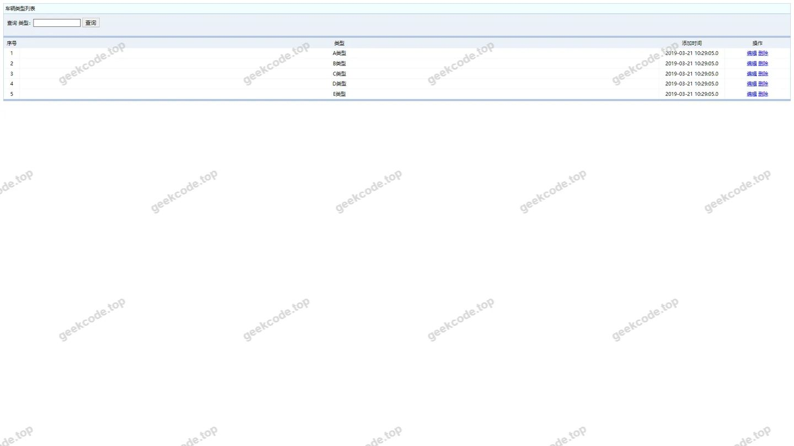
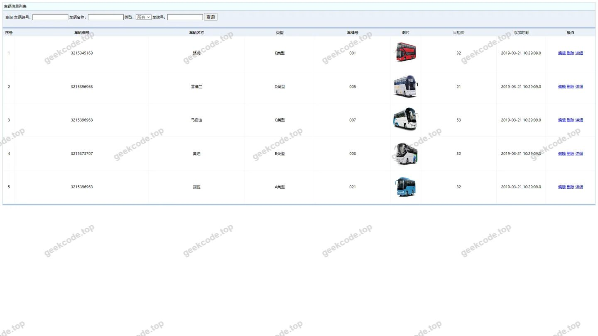
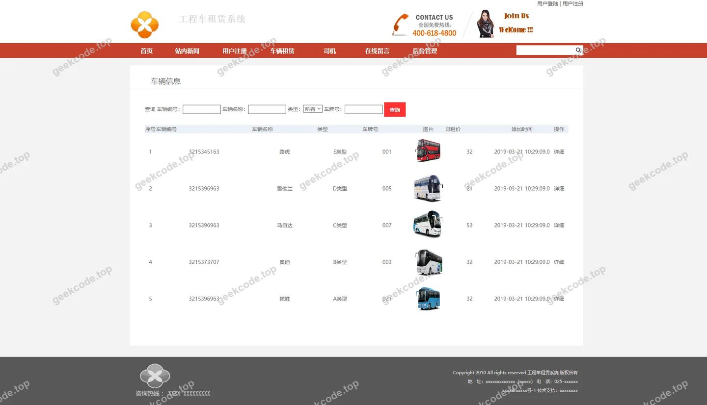
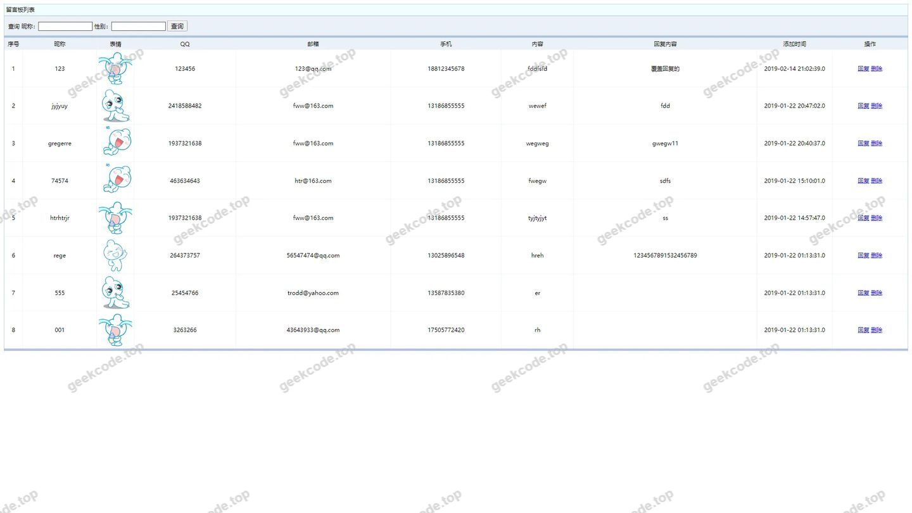
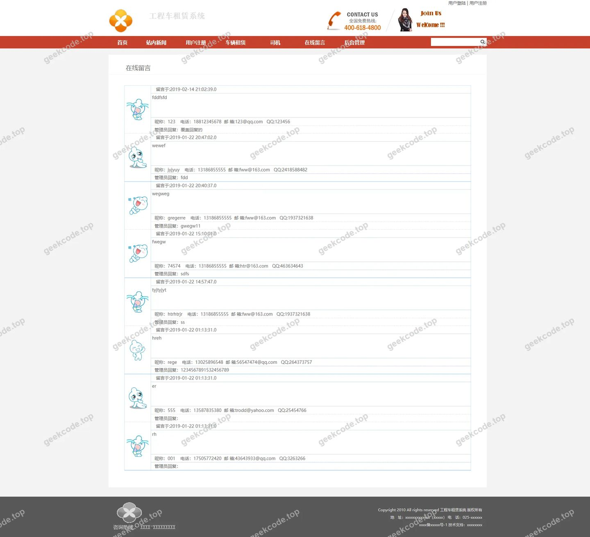
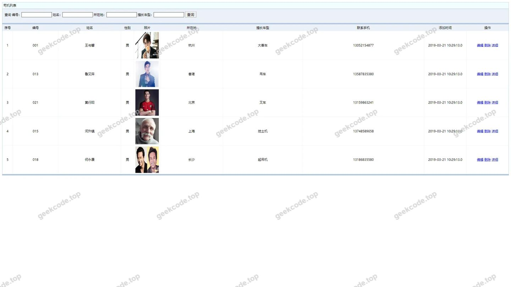
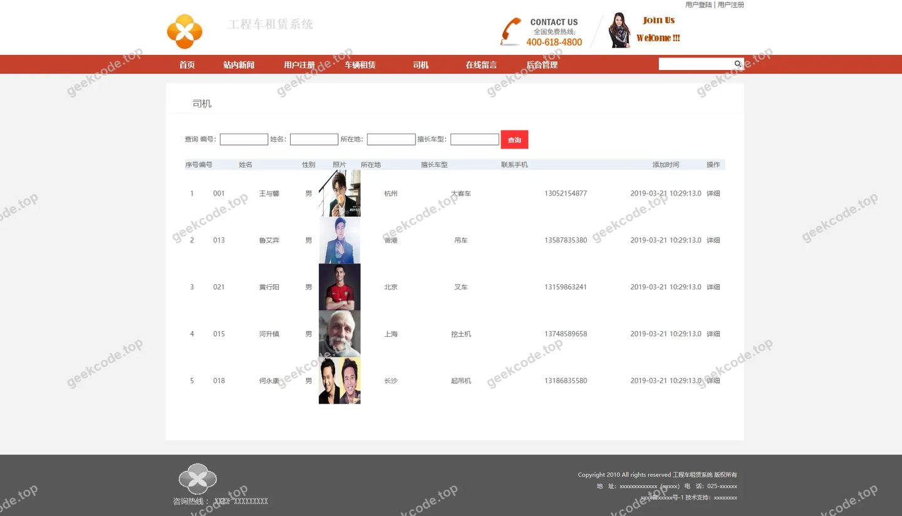
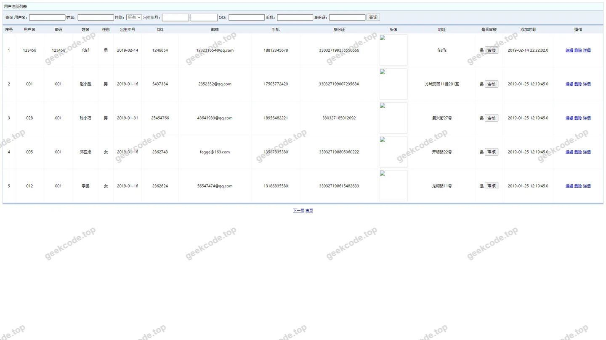
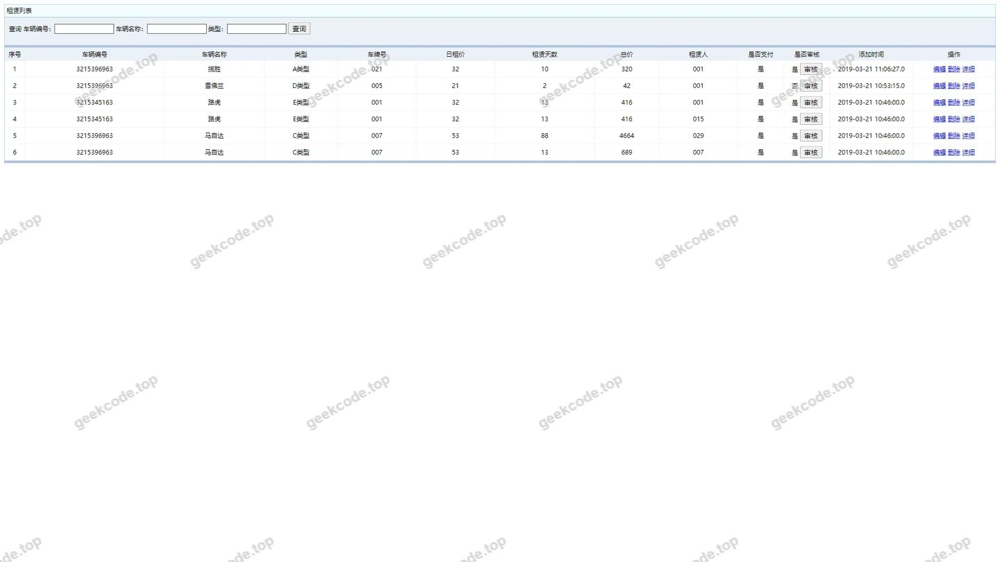
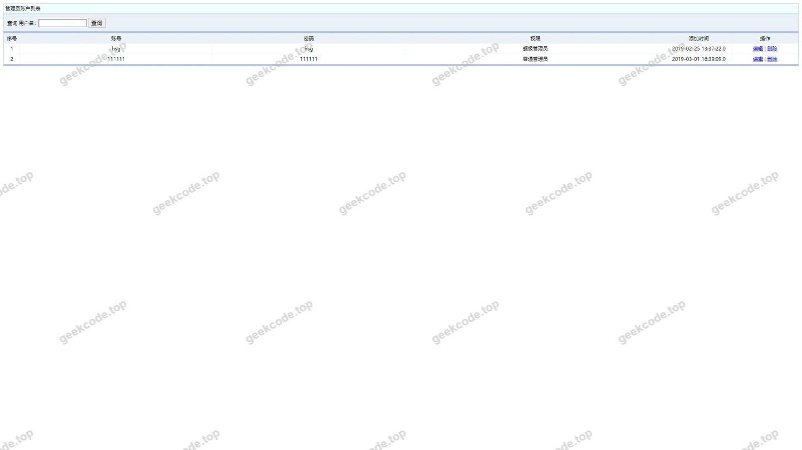

# ssm工程车辆租赁系统

> 🎓 **计算机毕业设计 · ssm工程车辆租赁系统**
>
> 本仓库只放**项目介绍 + 运行截图**（截图是站点带水印的原图，存在仓库 `images/` 里）。
>
> 👉 **完整可运行源码 / 数据库脚本 / 部署文档：[点我获取](https://geekcode.top/archives/ssm%E5%B7%A5%E7%A8%8B%E8%BD%A6%E8%BE%86%E7%A7%9F%E8%B5%81%E7%B3%BB%E7%BB%9F?utm_source=github)**
>
> 💬 咨询微信：**ir9372**　|　🌐 更多项目：[极客代码 geekcode.top](https://geekcode.top/?utm_source=github)
>
> 📌 项目详情页：<https://geekcode.top/archives/ssm%E5%B7%A5%E7%A8%8B%E8%BD%A6%E8%BE%86%E7%A7%9F%E8%B5%81%E7%B3%BB%E7%BB%9F?utm_source=github>

<table><td width="230" align="center"> <b>扫码加微信 ir9372</b></td><td valign="middle">📦 源码 = 项目介绍 + 全部运行截图 + 数据库 + 部署文档 👉 点上方任意截图，直接跳到 <b>极客代码 geekcode.top</b> 详情页</td></table>

---

<h1>ssm工程车辆租赁系统</h1>
<h2>项目概述</h2>

本工程车辆租赁系统基于 SSM（Spring + Spring MVC + MyBatis）框架与 JSP 前端技术构建，旨在实现工程车辆的全流程数字化管理。系统核心功能涵盖用户注册登录、车辆类型与信息维护、司机信息管理、租赁业务处理、在线留言反馈以及新闻公告发布等模块。该项目主要服务于车辆租赁企业的内部管理人员及注册用户，通过标准化的 Web 界面实现数据的高效录入、查询与维护。由于项目明确标识为“无前台导航菜单”、“无个人中心菜单”且“无后台路由”，其交互逻辑主要通过列表页展示与编辑页操作完成，侧重于基础数据的 CRUD（增删改查）管理，适用于中小型车辆租赁场景下的信息化过渡阶段。

<h2>技术架构</h2>

本项目采用经典的 Java Web 三层架构设计，后端基于 SSM 框架体系，前端使用 JSP 进行页面渲染。

<ol>
<li><strong>持久层（DAO）</strong>：使用 MyBatis 作为 ORM 框架，通过 XML 配置文件或注解映射 SQL 语句，实现对 MySQL 数据库的直接操作，负责车辆信息、用户数据、租赁记录等业务实体的持久化存储。</li>
<li><strong>业务逻辑层（Service）</strong>：由 Spring 容器管理 Bean 的生命周期，封装具体的业务规则，如租赁状态变更校验、用户权限判断等，确保数据一致性。</li>
<li><strong>表现层（Controller/View）</strong>：利用 Spring MVC 处理 HTTP 请求，接收前端表单数据并调用 Service 层方法；JSP 页面负责动态展示数据列表（如 allusers, cheliangxinxi 等）及提供编辑表单入口。</li>
<li><strong>数据库设计</strong>：虽未提供具体 DDL，但根据截图中的实体名称（cheliangleixing, siji, zulin 等），数据库至少包含车辆类型表、车辆信息表、司机表、租赁订单表、用户表、留言表及新闻表等核心结构，各表间通过外键关联以维持数据完整性。</li>
</ol>
<h2>功能模块</h2>

根据提供的截图功能列表，系统主要划分为以下数据管理与业务操作模块：

<h3>基础信息管理</h3>
<ul>
<li><strong>用户管理</strong>：支持用户注册（yonghuzhuce）、所有用户列表查看（allusers）及用户信息更新（allusersupdt）。</li>
<li><strong>车辆资源管理</strong>：包含车辆类型定义（cheliangleixing）、车辆详细信息维护（cheliangxinxi/clxx）。</li>
<li><strong>人员管理</strong>：针对司机信息的录入与管理（siji/sj）。</li>
</ul>
<h3>业务办理模块</h3>
<ul>
<li><strong>租赁管理</strong>：处理车辆租赁业务的核心流程，包括租赁记录的创建、查询与管理（zulin）。</li>
</ul>
<h3>内容与服务模块</h3>
<ul>
<li><strong>资讯发布</strong>：新闻通知的发布与管理（xinwentongzhi），用于向用户传达最新政策或车辆动态。</li>
<li><strong>互动反馈</strong>：在线留言板功能（liuyanban/lyb），允许用户对服务进行评价或咨询。</li>
<li><strong>外部链接</strong>：友情链接管理（youqinglianjie），用于扩展网站资源。</li>
</ul>
<h3>系统维护</h3>
<ul>
<li><strong>通用编辑</strong>：提供统一的编辑接口（页面-编辑 admin），用于对各类数据实体进行修改操作。</li>
<li><strong>身份验证</strong>：登录页（other）作为系统入口，保障数据安全。</li>
</ul>
<h2>用户角色与权限</h2>

鉴于项目标记为“无后台路由”且仅存在单一的“admin”编辑入口及通用的“other”列表页，系统角色划分较为扁平，主要依赖登录状态区分访问权限：

<ol>
<li><strong>管理员（Admin）</strong></li>
</ol>
<ul>
<li><strong>权限范围</strong>：拥有最高权限，可访问所有数据列表页面（allusers, cheliangxinxi, zulin 等）。</li>
<li><strong>具体操作</strong>：</li>
<li>执行所有实体的新增、修改、删除操作（通过“页面-编辑 (admin)”及“allusersupdt”等更新页面）。</li>
<li>管理新闻通知、友情链接及留言板回复。</li>
<li>审核用户注册信息及司机资料。</li>
</ul>
<ol start="2">
<li><strong>普通用户（User）</strong></li>
</ol>
<ul>
<li><strong>权限范围</strong>：基于“yonghuzhuce”和“liuyanban”的存在，推测普通用户具备注册和浏览特定公开信息的权限。</li>
<li><strong>具体操作</strong>：</li>
<li>注册账号并登录系统。</li>
<li>浏览车辆信息列表（clxx/cheliangxinxi）以选择租赁车辆。</li>
<li>发起租赁申请（对应 zulin 模块的数据插入）。</li>
<li>在留言板发表留言（liuyanban/lyb）。</li>
<li>查看新闻通知。</li>
<li><em>注：由于缺乏明确的个人中心和后台路由隔离，普通用户的操作边界依赖于代码层面的 Session 校验，而非独立的 URL 路径隔离。</em></li>
</ul>
<h2>项目特色与创新点</h2>
<ol>
<li><strong>轻量级传统架构应用</strong>：项目摒弃了复杂的前端框架，采用成熟的 SSM+JSP 组合，具有开发成本低、部署简单、易于维护的特点，适合毕业设计快速迭代与演示。</li>
<li><strong>全链路业务闭环</strong>：涵盖了从“车辆入库”到“司机匹配”再到“租赁成交”及“售后反馈”的完整业务链条，数据结构设计紧密贴合实际工程车辆租赁场景。</li>
<li><strong>模块化数据管理</strong>：将车辆类型、车辆信息、司机、租赁订单分离为独立的管理列表，体现了高内聚低耦合的设计思想，便于后期功能的扩展与维护。</li>
</ol>
<h2>部署环境</h2>

为确保系统正常运行，需准备以下软件环境：

<ol>
<li><strong>操作系统</strong>：Windows 7/10/Server 或 Linux CentOS 7+。</li>
<li><strong>Java 运行环境</strong>：JDK 1.8 或更高版本（建议 JDK 1.8，兼容 SSM 主流版本）。</li>
<li><strong>Web 服务器</strong>：Apache Tomcat 8.5 或 9.0（需配置 JSP 编译支持）。</li>
<li><strong>数据库</strong>：MySQL 5.7 或 MySQL 8.0，需安装 JDBC 驱动包（mysql-connector-java）。</li>
<li><strong>构建工具</strong>：Maven 3.x（若项目源码包含 pom.xml）或手动导入 jar 包。</li>
<li><strong>浏览器</strong>：Chrome、Firefox 或 Edge 等现代浏览器（需兼容 HTML4/JSP 标准）。</li>
</ol>
<h2>五、技术特性</h2>
<ul>
<li>服务端模板渲染（JSP）</li>
</ul>
<h2>六、功能模块截图</h2>
<h3>前台用户端</h3>
<h4>登录页</h4>

<h4>页面-cheliangleixing列表</h4>

<h4>页面-cheliangxinxi列表</h4>

<h4>页面-clxx列表</h4>

<h4>页面-liuyanban列表</h4>

<h4>页面-lyb列表</h4>

<h4>页面-siji列表</h4>

<h4>页面-sj列表</h4>

<h4>页面-xinwentongzhi列表</h4>

<h4>页面-yonghuzhuce列表</h4>

<h4>页面-youqinglianjie列表</h4>

<h4>页面-zulin列表</h4>

<h4>页面-allusersupdt</h4>

<h4>页面-编辑</h4>

<h3>后台管理端</h3>
<h4>页面-allusers列表</h4>

---

## 获取完整源码

| 项目 | 说明 |
| --- | --- |
| 项目名 | ssm工程车辆租赁系统 |
| 运行截图 | 本文 15 张（站点带水印原图，仓库 `images/` 目录） |
| 完整源码 | [https://geekcode.top/archives/ssm%E5%B7%A5%E7%A8%8B%E8%BD%A6%E8%BE%86%E7%A7%9F%E8%B5%81%E7%B3%BB%E7%BB%9F?utm_source=github](https://geekcode.top/archives/ssm%E5%B7%A5%E7%A8%8B%E8%BD%A6%E8%BE%86%E7%A7%9F%E8%B5%81%E7%B3%BB%E7%BB%9F?utm_source=github) |
| 咨询微信 | **ir9372**（备注：jingpin-yuanma） |
| 更多项目 | [极客代码 geekcode.top](https://geekcode.top/?utm_source=github) |

> 需要源码、部署、改配置、跑不起来等问题，加微信 ir9372 沟通，说明项目名即可。
